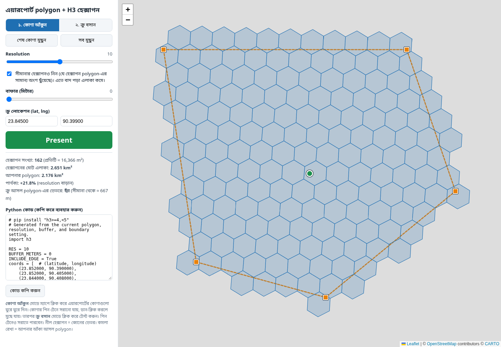
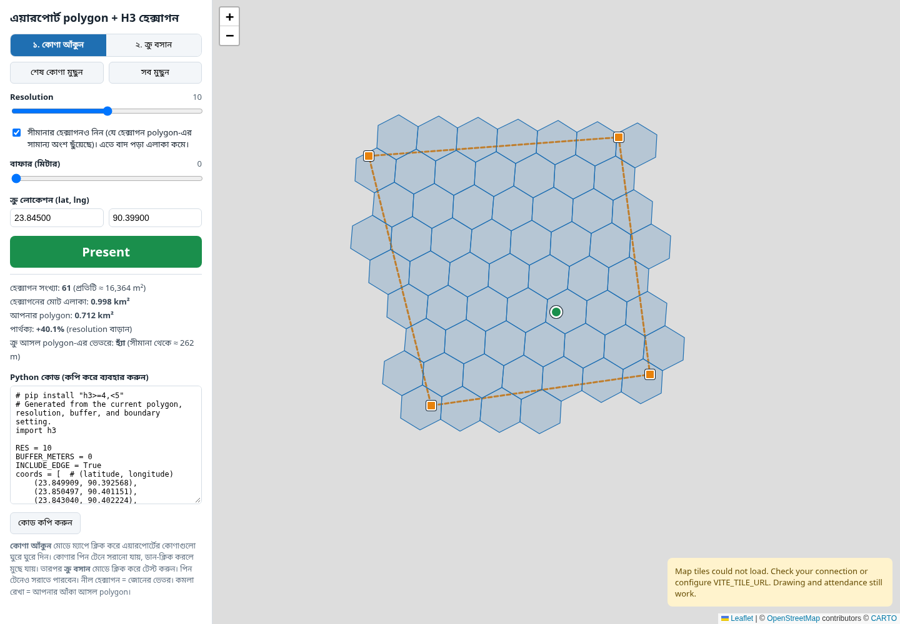
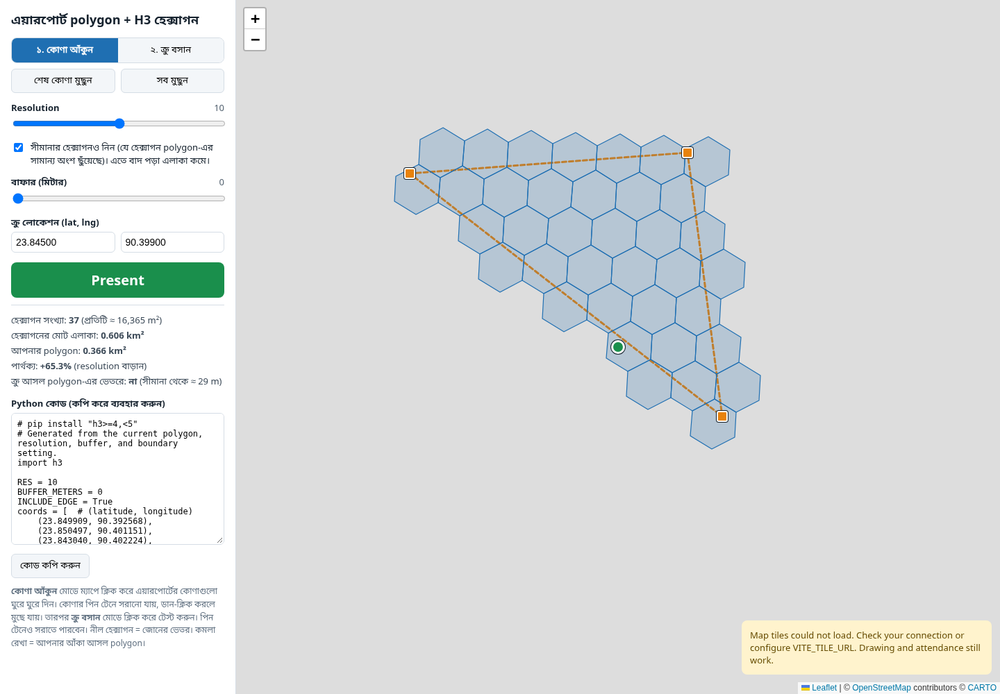
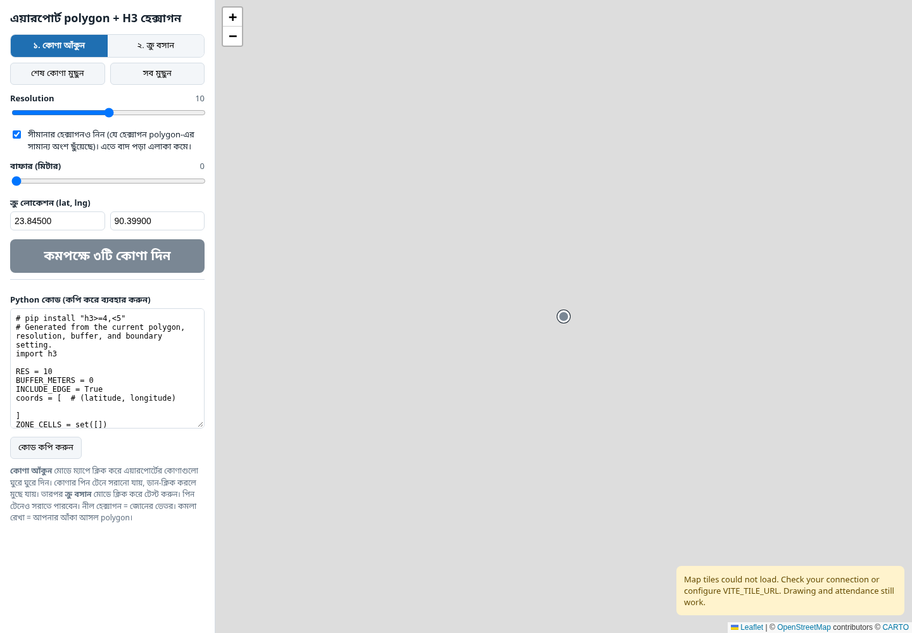
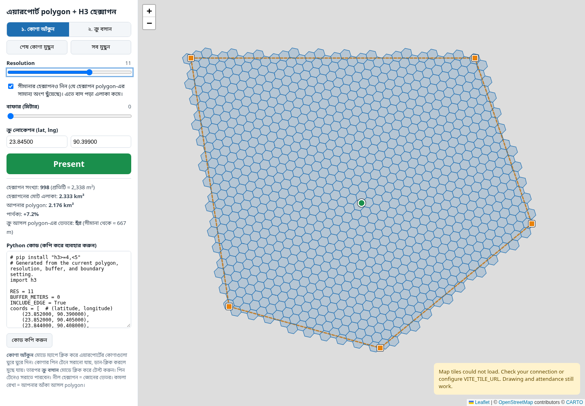
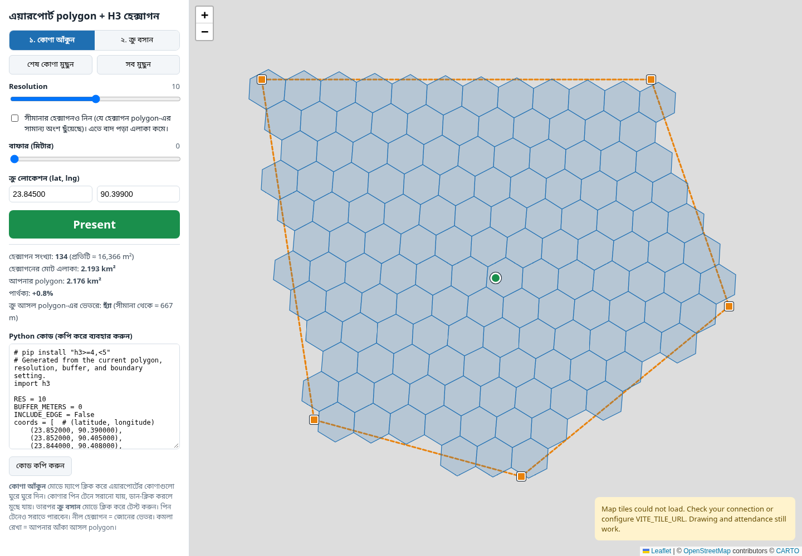
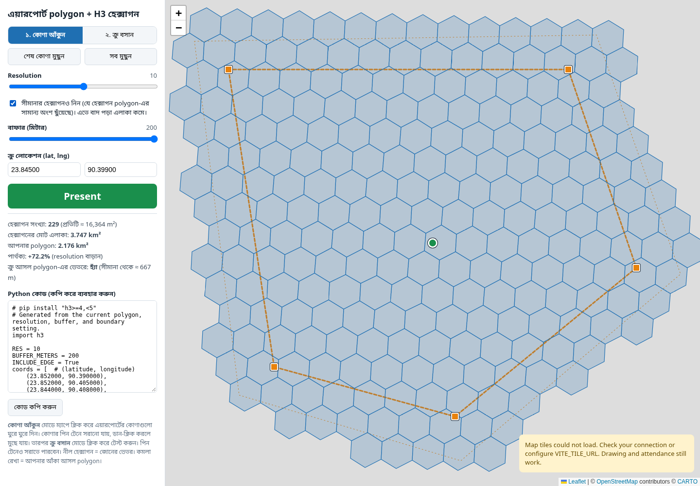
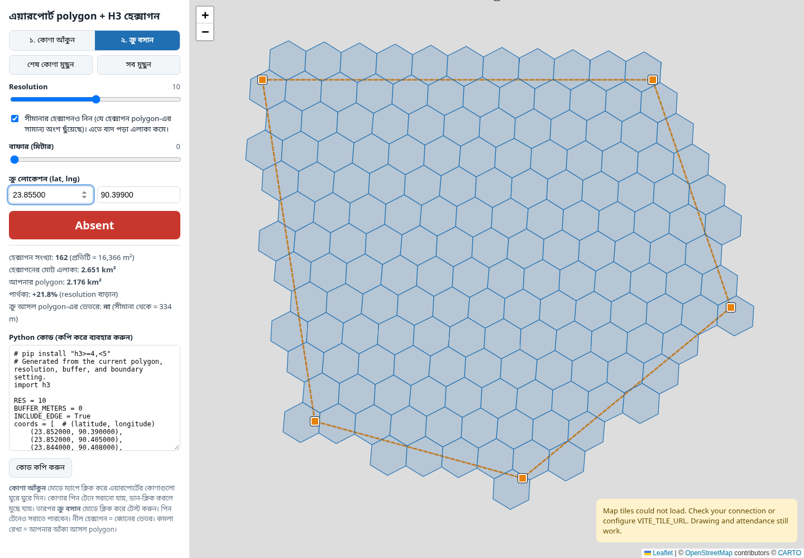
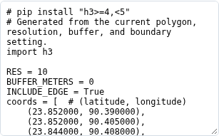
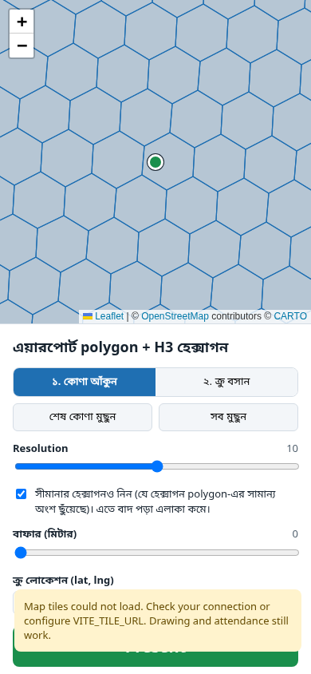

# H3 Airport Geofence

An interactive map for drawing airport zones, covering them with H3 hexagons, and checking crew attendance by location. The Bengali interface combines polygon editing, adjustable hexagon coverage, location statistics, and Python code export.

Built with **Node.js, Vite, Leaflet, and H3**.

## Project flow

1. Draw or edit the airport boundary on the map.
2. Choose the H3 resolution, boundary-cell setting, and buffer distance.
3. Place the crew marker or enter latitude and longitude.
4. View **Present / Absent**, coverage statistics, and distance from the polygon boundary.
5. Copy the generated Python code to use the current H3 zone in an attendance workflow.

## Airport zone and attendance overview

The project opens with a sample polygon near Dhaka airport. Orange corners define the airport boundary, blue hexagons represent the attendance zone, and the circular marker represents the crew location. A green **Present** result means the crew's H3 cell belongs to the displayed zone.

## Draw and edit a polygon

Select **কোণা আঁকুন** and click the map to add corners in boundary order. Drag a corner to reposition it, or right-click a corner to remove it. The polygon and H3 coverage update as the boundary changes.

### Undo the last corner

**শেষ কোণা মুছুন** removes the most recently added corner and recalculates the zone.

### Clear the zone

**সব মুছুন** removes all polygon corners and returns to drawing mode. At least three corners are required to generate a zone and check attendance.

## Adjust H3 resolution

The resolution slider supports levels **7–13**. Higher resolutions produce smaller hexagons for finer coverage; lower resolutions produce larger hexagons. Cell count and coverage statistics update with the selected resolution.

## Include boundary cells

The boundary checkbox adds nearby cells using polygon-center and vertex checks. Turning it off uses the standard H3 polygon fill based on cell centers. This setting changes the displayed attendance zone; boundary coverage is approximate for narrow or complex shapes.

## Add a buffer

The buffer slider expands the polygon's vertices outward from their mean center by **0–200 meters**. A second orange outline shows the expanded boundary, and H3 coverage follows the buffered polygon. This is an approximate radial expansion.

## Place crew and check attendance

Select **ক্রু বসান** and click the map, drag the circular crew marker, or enter latitude and longitude. Attendance uses the crew location's H3 cell:

- **Present:** the cell belongs to the current zone.
- **Absent:** the cell is outside the current zone.

The statistics also show whether the crew is inside the original polygon and the approximate distance to its nearest boundary.

## Coverage statistics

The statistics panel displays:

- Number of H3 cells and approximate area per cell.
- Total hexagon coverage area in square kilometers.
- Original polygon area in square kilometers.
- Percentage difference between hexagon coverage and polygon area.
- Crew membership in the original polygon and approximate boundary distance.

These values update when the polygon, resolution, buffer, boundary setting, or crew location changes.

## Export Python attendance code

The code panel generates Python for the current zone, including polygon coordinates, resolution, buffer setting, boundary-cell setting, and the computed H3 cell set. Use **কোড কপি করুন** to copy it. The exported `check_attendance(lat, lng)` function returns **Present** or **Absent** using the same cell membership as the map and requires Python `h3>=4,<5`.

## Mobile layout

On narrow screens, the map appears above a scrollable control panel. Polygon editing, attendance checks, settings, statistics, and Python export remain available.

